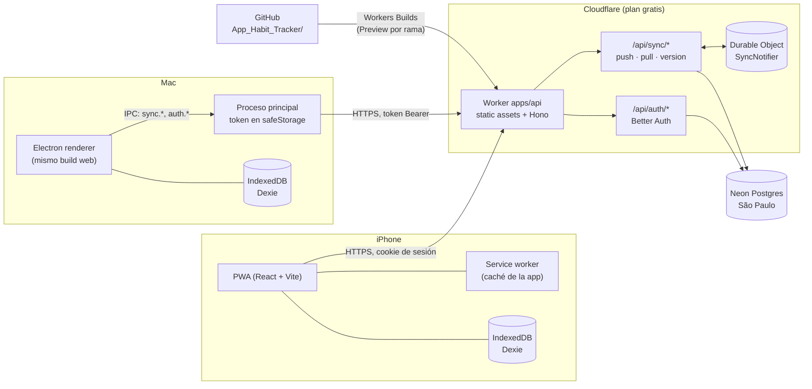

# Arquitectura

App personal de hábitos y gimnasio. Es offline-first y se sincroniza entre el iPhone (PWA) y el Mac (Electron). Las decisiones y sus porqués están en [`decisions/`](decisions/README.md); el modelo de datos, en [`modelo-de-datos.md`](modelo-de-datos.md).

## Vista general



- **El dispositivo manda.** La interfaz solo lee y escribe en Dexie. La sincronización corre aparte y nunca bloquea una pantalla (ADR 0002 y 0006).
- **Un solo origen.** El Worker entrega la web y la API, así que la PWA usa cookies del propio sitio y no necesita CORS (ADR 0003).
- **Neon duerme casi siempre.** El "¿hay algo nuevo?" lo responde el Durable Object. Neon solo despierta para un *push* o un *pull* real (ADR 0004 y 0006).

## Estructura del repositorio

```
App_Habit_Tracker/
├─ apps/
│  ├─ web/        React + Vite, PWA (vite-plugin-pwa). Pantallas, Dexie, cliente de sync
│  ├─ api/        Worker de Cloudflare: Hono, Better Auth, Drizzle, Durable Object
│  └─ desktop/    Electron: proceso principal, preload, empaquetado (electron-builder)
├─ packages/
│  └─ shared/     Esquemas Zod, tipos y lógica pura (rachas, cuotas, fechas, 1RM, volumen, sync)
├─ docs/          Esta documentación
├─ CLAUDE.md      Reglas para trabajar en la app
└─ README.md
```

`packages/shared` no depende de nada del navegador ni de Cloudflare: se prueba en Node con Vitest y lo usan las tres apps.

## Entornos

| Entorno | Web y API | Base de datos | Cuándo se usa |
| --- | --- | --- | --- |
| `dev` | Vite + `wrangler dev` en tu Mac | Postgres en Docker (o la rama `dev` de Neon) | Desarrollo y pruebas locales |
| CI | GitHub Actions | Postgres como servicio del job | Cada push y cada PR |
| `preview` | Preview de Workers por rama (`*.workers.dev`) | Rama `preview` de Neon | Revisar una PR en el iPhone real |
| `production` | Worker en `*.workers.dev` | Rama `production` de Neon | Desde la fase 6, solo con tu confirmación |

Los secretos de cada entorno (URL de la base, secreto de Better Auth) viven solo en Cloudflare, en los secretos de GitHub o en tu `.env.local`. Nunca en el repo (ver [`cuentas.md`](cuentas.md)).

## Límites de los planes gratis (RNF-20)

| Servicio | Límite que importa | Qué pasa si se alcanza | Margen esperado |
| --- | --- | --- | --- |
| Cloudflare Workers | 100.000 peticiones al día, 10 ms de CPU por petición | Error 1027 (peticiones) o 1102 (CPU). La app sigue funcionando sin conexión | ~6.000 peticiones al día. El login es el único punto con CPU en riesgo (ADR 0005) |
| Durable Objects | 100.000 peticiones al día | Falla el aviso de cambios; la sincronización sigue al abrir la app o al hacer push | ~6.000 al día |
| Workers Logs | 200.000 registros al día, 3 días de retención | Se dejan de registrar eventos | Holgado |
| Workers Builds | 3.000 minutos al mes | No se construyen más previews ese mes | ~2 minutos por build |
| Neon | 100 CU-horas al mes, 1 GB, 5 GB de salida | Se suspende el cómputo (o se bloquean las escrituras si se pasa 1 GB). No se borra nada | ~15 CU-horas al mes, unos MB de datos |
| GitHub Actions | Gratis en repos públicos con runners estándar | — | — |

Ninguno de estos servicios cobra por sí solo si se pasa el límite: simplemente se detiene. Si alguna vez hubiera que pasar a un plan pagado, te lo digo antes.

## Limitaciones conocidas de iOS (PWA)

| Limitación | Efecto en la app | Mitigación |
| --- | --- | --- |
| WebKit puede borrar los datos del sitio si no se usa por un tiempo o si falta espacio | Se perdería lo que no se sincronizó | Instalar la PWA en la pantalla de inicio, `navigator.storage.persist()` y sincronizar a menudo |
| No hay sincronización en segundo plano (`SyncManager`) | Solo sincroniza con la app abierta | Sincronizar al abrir, al volver, al recuperar la conexión y cada 15 s mientras esté visible |
| No hay vibración (`navigator.vibrate`) | El temporizador de descanso no vibra | Aviso visual y, si iOS lo permite, sonido |
| Las notificaciones push solo funcionan con la app instalada (iOS 16.4+) | No hay recordatorios en Safari normal | Fase 7 (opcional) |

En la fase 4 se vuelven a verificar, con la versión de iOS que tengas.

## Seguridad (resumen)

| Requisito | Dónde se cumple |
| --- | --- |
| Sin secretos en el frontend ni en el repo | Secretos solo en Cloudflare, GitHub y `.env.local`. `.gitignore` y escaneo de secretos |
| Acceso por usuario en todas las tablas | `user_id` sacado de la sesión. Tests de aislamiento en la API (ADR 0004) |
| Validación en el servidor | Esquemas Zod de `packages/shared` en cada ruta de Hono |
| Contraseñas, límite de intentos y cookies | Better Auth: `scrypt`, limitador en la base, cookies `HttpOnly`, `Secure` y `SameSite=Lax` (ADR 0005) |
| Cabeceras (CSP, `frame-ancestors 'none'`, etc.) | Middleware del Worker, en las fases 2 y 6 |
| Electron endurecido | ADR 0008, verificado en las fases 5 y 6 |
| Registro público cerrado | `AUTH_SIGNUP_ENABLED=false` en producción, con un test |
| Dependencias auditadas | `pnpm audit` en el CI |
