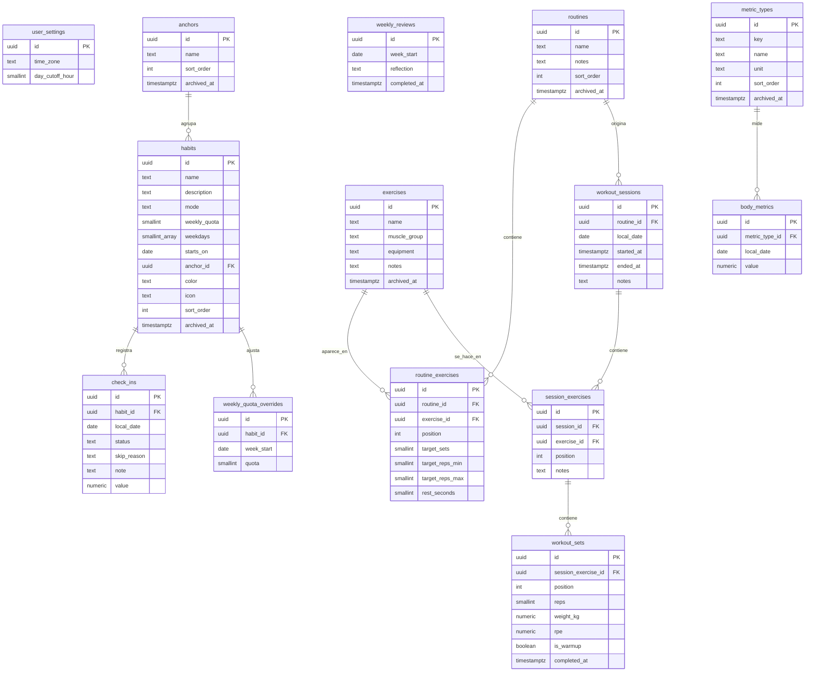

# Modelo de datos

Es una propuesta de la fase 0. Los tipos exactos quedan fijados en los esquemas Zod de `packages/shared` y en las migraciones de Drizzle. Las reglas de sincronización están en el [ADR 0006](decisions/0006-sincronizacion.md), y las de fechas en el [ADR 0007](decisions/0007-fechas-y-zona-horaria.md).

## Columnas comunes

Todas las tablas sincronizables tienen estas columnas. En el servidor, la clave primaria es `(user_id, id)`.

| Columna | Tipo (Postgres) | Notas |
| --- | --- | --- |
| `user_id` | `text` | Usuario dueño. Solo existe en el servidor y se toma de la sesión, nunca del cliente |
| `id` | `uuid` | Lo genera el cliente: aleatorio, o UUID v5 de la clave natural (ver más abajo) |
| `created_at` | `timestamptz` | Hora del dispositivo al crear |
| `updated_at` | `timestamptz` | Hora del dispositivo al editar. Decide los conflictos |
| `deleted_at` | `timestamptz null` | Borrado lógico |
| `server_seq` | `bigint` | Lo asigna el servidor desde la secuencia `sync_seq`. Es el cursor de *pull*. Índice `(user_id, server_seq)` |

Entre tablas sincronizables **no hay claves foráneas** en el servidor. Con borrado lógico y lotes que pueden llegar en distinto orden, una clave foránea rechazaría lotes válidos. La integridad la cuidan la app y los esquemas Zod. El *push* envía primero las tablas "padre".

## Diagrama

## Tablas

### Hábitos

| Tabla | Campos clave y reglas |
| --- | --- |
| `user_settings` | Una fila por usuario, con `id` fijo. `time_zone` (por defecto `America/Santiago`) y `day_cutoff_hour` (0–6, por defecto 4) |
| `anchors` | Lista editable. Por defecto: Al despertar, Mañana, Después de almorzar, Tarde, Noche, Antes de dormir, Después de entrenar. `name` de 1 a 40 caracteres |
| `habits` | `mode`: `daily` o `weekly_quota`. `weekly_quota` va de 1 a 7 y es obligatoria solo con `weekly_quota`. `weekdays`: días ISO 1–7 en que aplica (solo `daily`; por defecto todos). `starts_on`: fecha local desde la que cuenta (por defecto, el día en que se crea); los días anteriores no afectan las rachas. `archived_at` archiva el hábito sin borrar su historial (HU-6) |
| `check_ins` | Uno por hábito y día. `id` = UUID v5 de `check_in:{habit_id}:{local_date}`. `status`: `done` o `skipped`. `skip_reason` (solo con `skipped`): `certamen`, `enfermedad`, `viaje`, `descanso` u `otro`. `note` hasta 280 caracteres. `value` es numérico opcional, reservado para metas con número y sin interfaz en la v1. Desmarcar = borrado lógico |
| `weekly_quota_overrides` | La cuota de un hábito en una semana, si es distinta de la normal (revisión del domingo, RF-1.4). `id` = UUID v5 de `quota:{habit_id}:{week_start}`. `quota` de 0 a 7 |
| `weekly_reviews` | La reflexión de la semana (RF-1.6). `id` = UUID v5 de `review:{week_start}` |

"Pausar el día" no tiene tabla propia: crea un check-in `skipped` con el mismo motivo para cada hábito pendiente de hoy.

### Gimnasio

| Tabla | Campos clave y reglas |
| --- | --- |
| `exercises` | `muscle_group`: `pecho`, `espalda`, `hombros`, `biceps`, `triceps`, `cuadriceps`, `isquiotibiales`, `gluteos`, `pantorrillas` o `core`. `equipment`: `free_weight`, `machine` o `bodyweight`. Los del catálogo inicial tienen `id` = UUID v5 de `exercise:{slug}` |
| `routines` | Plantillas editables. Las dos rutinas iniciales usan UUID v5 de `routine:{slug}` |
| `routine_exercises` | Orden (`position`), series objetivo (1–10), rango de repeticiones (`target_reps_min`–`target_reps_max`) y descanso sugerido en segundos |
| `workout_sessions` | `routine_id` opcional (null = sesión vacía). `local_date` según el ADR 0007. `ended_at` null = sesión en curso |
| `session_exercises` | Los ejercicios de una sesión, en orden |
| `workout_sets` | `reps` de 0 a 100. `weight_kg` de 0 a 1000, con 2 decimales (en mancuernas, el peso de una). `rpe` opcional de 1 a 10, en pasos de 0,5. `is_warmup` excluye la serie del volumen y de los récords |

### Cuerpo

| Tabla | Campos clave y reglas |
| --- | --- |
| `metric_types` | Lista editable. Por defecto: `weight` (kg) y en cm `neck`, `chest`, `waist`, `hips`, `arm_left`, `arm_right`, `thigh_left`, `thigh_right`, `calf_left`, `calf_right`. `id` = UUID v5 de `metric_type:{key}` |
| `body_metrics` | Una por tipo y fecha (RF-2.5). `id` = UUID v5 de `body_metric:{metric_type_id}:{local_date}`. `value` con 2 decimales |

### Solo en el servidor

- **Better Auth:** `user`, `session`, `account`, `verification` y `rateLimit`. Las crea su propia migración y no se sincronizan.
- **`sync_seq`:** la secuencia global de `server_seq`.

### Solo en el cliente (Dexie)

- Las mismas tablas sincronizables, sin `user_id`.
- `outbox`: `(table, id)` de las filas pendientes de subir, con la hora en que se encolaron.
- `sync_state`: cursor, último éxito, último error y estado visible.

## Cálculos (lógica pura en `packages/shared`)

| Cálculo | Regla |
| --- | --- |
| Racha diaria (RF-1.3) | Días aplicables consecutivos hacia atrás desde ayer, más hoy si ya está `done`. `done` suma 1. `skipped` no suma, pero no corta. Un día aplicable pasado sin registro corta la racha. Hoy sin registro no la corta todavía |
| Progreso semanal (RF-1.4) | `done` de la semana / cuota efectiva (`weekly_quota_overrides.quota` si existe; si no, `habits.weekly_quota`) |
| Racha semanal (respuesta 10) | Semanas cerradas consecutivas con la cuota cumplida, más la actual si ya se cumplió. Una semana con cuota 0 (en pausa) no suma ni corta. La semana en que empieza el hábito suma si se cumplió y, si no, no corta |
| 1RM estimado (Epley) | `peso × (1 + reps / 30)`, solo con series no de calentamiento. Con 1 repetición, el 1RM es el peso. Con más de 12 repeticiones no se estima, porque la fórmula pierde precisión |
| Volumen semanal | Suma de `reps × weight_kg` de las series no de calentamiento de la semana (lunes a domingo) |
| Récords personales | Por ejercicio: mayor peso, mayor 1RM estimado y mayor volumen en una sesión |

Estas reglas se prueban primero (TDD) en la fase 1 (hábitos) y en la fase 3 (gimnasio).
